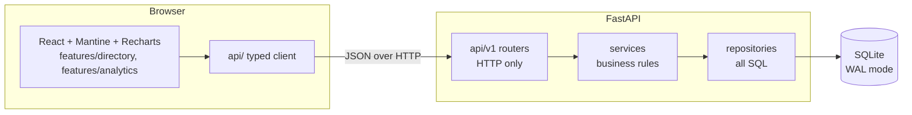
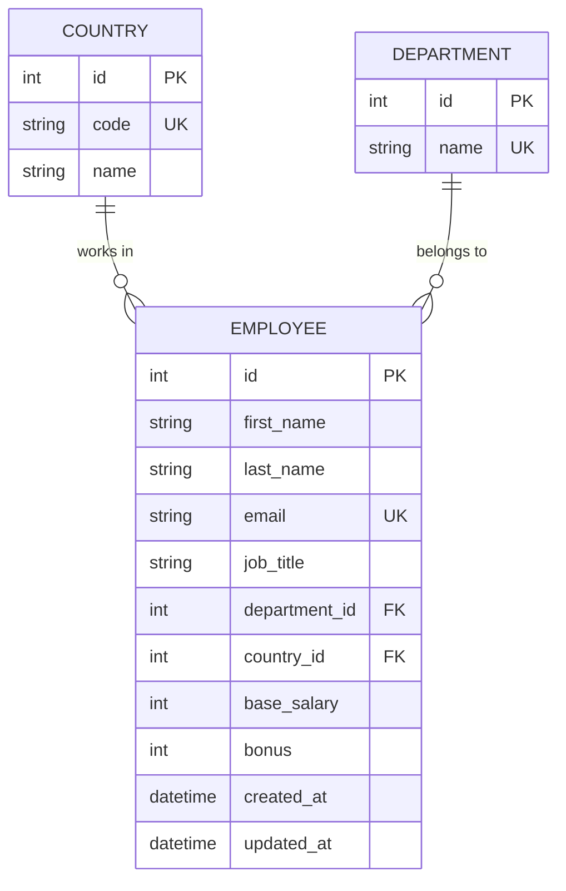

# Architecture

## Overview

A React single-page app talks to a FastAPI service over JSON. The service reads and writes one SQLite database. All filtering, sorting, pagination and aggregation run in SQL, so the browser never holds more than one page of employees.

## Backend layering

| Layer | Owns | Must not |
|---|---|---|
| `api` (routers) | Parse query and body into schemas, call one service method, return the response schema | Contain SQL or business rules |
| `services` | Business rules: not-found handling, rounding, band definitions, response shaping | Import FastAPI or write SQL |
| `repositories` | Every query: filters, sorting, pagination, aggregation | Contain business rules or HTTP concerns |
| `schemas` | Pydantic request and response models, field-level validation | Touch the database |
| `models` | SQLAlchemy tables, indexes, constraints | Contain logic |
| `core`, `db` | Settings; engine, session factory, per-request session, SQLite pragmas | |

Dependencies are injected through FastAPI `Depends` (session, then repository, then service). Domain exceptions (`EmployeeNotFoundError`) are mapped to HTTP responses in one place, `app/main.py`. Repository inputs and outputs are frozen Pydantic models rather than dataclasses, so the project uses one modelling style.

## API

All routes live under `/api/v1`.

| Method and path | Purpose |
|---|---|
| `GET /health` | Liveness |
| `GET /employees` | Paginated list. Query: `page`, `page_size` (1-100), `sort_by`, `order`, `search`, `country_id`, `department_id` |
| `PATCH /employees/{id}/salary` | Update `base_salary` (1 to 10,000,000) and `bonus` (0 to 10,000,000). 404 for an unknown id, 422 for invalid values |
| `GET /meta/filters` | Countries and departments for the filter dropdowns |
| `GET /analytics/summary` | Headcount, total payroll, average base, average total compensation, min and max base, highest-paid country |
| `GET /analytics/by-department`, `/by-country` | Headcount, average base, average bonus and total payroll per group |
| `GET /analytics/salary-bands` | Headcount per base-salary band |
| `GET /analytics/top-earners` | Top employees by total compensation (`limit`, 1-100) |

The analytics endpoints accept `country_id` and `department_id` filters.

## Data model

- Amounts are annual whole-dollar integers. Total compensation is `base_salary + bonus` and is computed, never stored, so it cannot drift from its parts.
- Database check constraints (`base_salary > 0`, `bonus >= 0`) back up the API validation.
- Country and department are separate tables so filters and group-bys join on integer keys.

## Indexing

Indexes exist on `department_id`, `country_id`, `first_name`, `last_name`, and a unique index on `email`. Measured query plans are in [PERFORMANCE.md](PERFORMANCE.md).

- Country and department filters use their foreign-key indexes.
- Sorting by name walks the `last_name` index.
- Sorting by salary, bonus or total compensation uses a temporary B-tree. That is cheap at 10,000 rows. Indexing the sum would need a generated column, which is not worth it here.

## Search trade-off

Search splits the input on whitespace. Each term must prefix-match the first name, last name or email (`term%`, with `%`, `_` and `\` escaped), and all terms must match.

- **Chosen:** prefix matching. It keeps results predictable ("ali" finds Alice, not Natalie) and avoids substring scans by design.
- **What it costs today:** SQLite's `LIKE` is case-insensitive for ASCII, and an index on a default-collation column cannot serve a case-insensitive `LIKE`. The query plan shows a full table scan, so the indexes help ordering and filters but not search. At 10,000 rows this takes about 7 ms. See [PERFORMANCE.md](PERFORMANCE.md).
- **Not chosen:** substring or full-text search. An FTS5 table would be the next step if the data set grows.
- Non-ASCII letters are matched case-sensitively, because SQLite's built-in case folding covers ASCII only.

## Other design choices

- **Whitelisted sorting.** `sort_by` is a literal type mapped to columns in the repository, so clients cannot sort on arbitrary expressions. Ties break by `id`, so pages never overlap or repeat rows.
- **No N+1 queries.** The list and top-earner queries load department and country with `contains_eager` in the same statement.
- **One transaction per write.** The repository commits the salary update.
- **Last write wins.** Concurrent edits are not detected, which suits the single-user persona.
- **Averages rounded in the service,** to two decimals, not in SQL.
- **Frontend data flow.** Each screen section fetches independently through `useAsyncData`, which discards stale responses. A failing analytics section shows its own error and retry without blanking the page. The directory resets to page 1 whenever search, filters or sort change.

## Future enhancements

| Enhancement | What it would take |
|---|---|
| Salary history and audit trail | A history table written in the same transaction as each update; a history view |
| Multi-currency with FX | A currency per employee, dated exchange rates, conversion inside every aggregate |
| Median and percentiles | PostgreSQL (`percentile_cont`), or computing them in the application |
| Authentication and roles | Login, sessions or tokens, a permission model |
| Employee create, delete and import | Forms, uniqueness rules, delete semantics, file parsing |
| Case-insensitive indexed search, then FTS | An index with `COLLATE NOCASE` (or a lowercase search column), then an FTS5 table for substring search |
| Optimistic concurrency | A version column checked on update, with a conflict response |
| Keyset pagination | Replace `OFFSET` if deep pages become slow |
